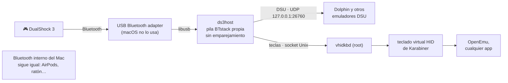
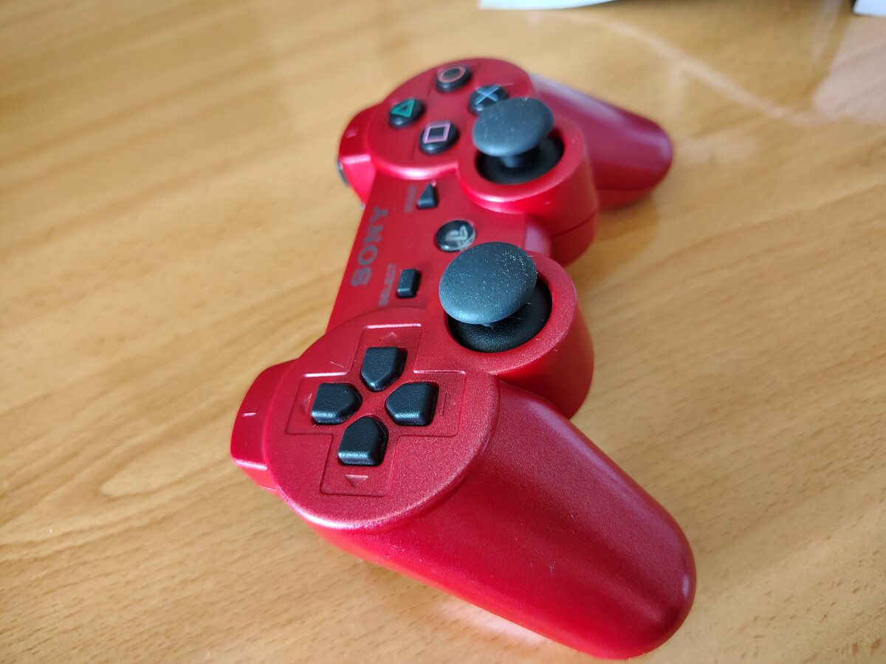
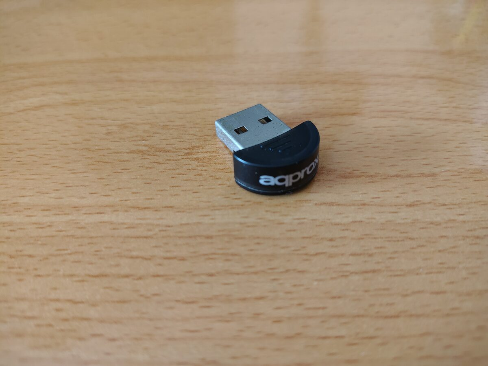
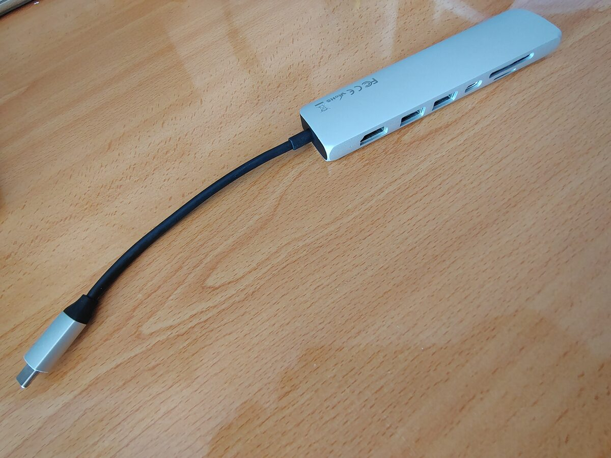
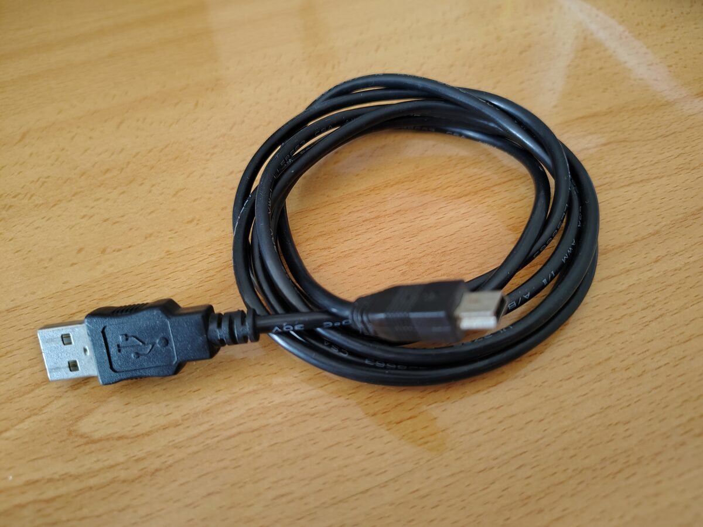

# DS3Bridge — DualShock 3 de PS3 por Bluetooth en macOS moderno

**Usa un mando DualShock 3 de PlayStation 3 sin cable en macOS moderno (macOS 13 o superior; probado en macOS 26 Tahoe con Apple Silicon).**

[Read in English](README.md)

Desde macOS Monterey, el DualShock 3 solo funciona **por cable** (con un activador tipo `ds3activate`). Por Bluetooth, macOS muestra una ventana pidiendo un código una y otra vez y corta la conexión a los ~30 s. DS3Bridge lo resuelve **sin desactivar SIP, sin extensiones de kernel y sin permisos especiales de Apple**, con:

- un **adaptador Bluetooth USB barato** que macOS no usa y que DS3Bridge controla directamente con su propia pila Bluetooth ([BTstack](https://github.com/bluekitchen/btstack)). El Bluetooth interno del Mac sigue funcionando igual para tus otros aparatos;
- un **servidor DSU (cemuhook)** para que emuladores como Dolphin lean el mando (botones, sticks, presión y movimiento básico);
- un **modo teclado** que convierte el mando en pulsaciones de teclas, mediante el [teclado virtual HID de Karabiner](https://github.com/pqrs-org/Karabiner-DriverKit-VirtualHIDDevice) (firmado; necesario para OpenEmu) o mediante teclas sintéticas.

> ⚠️ **Estado: experimental, proyecto personal.** Funciona en el equipo del autor (ver *Hardware probado*). Mira las [notas](#notas) más abajo.

## Cómo funciona (versión corta)



El DS3 nunca hace un emparejamiento Bluetooth real (no tiene clave de enlace). macOS 12+ exige emparejamiento autenticado a todo dispositivo HID Bluetooth, así que lo rechaza, y una app no puede saltarse esa política porque `bluetoothd` se queda con los canales HID. Con un segundo adaptador controlado por nuestra propia pila, la política de seguridad la decidimos *nosotros*, igual que hacía la PS3. La historia completa está en [docs/HOW_IT_WORKS.md](docs/HOW_IT_WORKS.md) (en inglés).

## Qué necesitas

- Un Mac con macOS 13 o posterior (desarrollado en macOS 26, Apple Silicon).
- Un **adaptador Bluetooth USB**. Solo se ha probado uno antiguo ISSC `0x1131:0x1004` (Bluetooth 2.1); otros adaptadores USB estándar *deberían* funcionar, pero no está confirmado: si pruebas el tuyo, cuéntalo. En Apple Silicon macOS no usa adaptadores externos, así que queda libre para DS3Bridge. Un hub USB-C o un adaptador USB-C a USB-A si tu Mac solo tiene USB-C.
- Un DualShock 3 (o Sixaxis) y un cable **Mini-USB** (solo para emparejarlo una vez).
- Las Command Line Tools de Xcode (`xcode-select --install`) y [Homebrew](https://brew.sh) con `libusb` y `pkg-config`.

### El hardware

<table>
<tr>
<td align="center" width="25%"><br><sub>DualShock 3</sub></td>
<td align="center" width="25%"><br><sub>Antena Bluetooth USB</sub></td>
<td align="center" width="25%"><br><sub>Hub USB-C (o adaptador USB-C a USB-A)</sub></td>
<td align="center" width="25%"><br><sub>Cable Mini-USB (solo para emparejar)</sub></td>
</tr>
</table>

## Paso a paso

### 1. Compilar

En Terminal:

```sh
brew install libusb pkg-config
git clone https://github.com/comechejlg/DS3Bridge.git
cd DS3Bridge
./build.sh
```

`build.sh` descarga BTstack y las cabeceras del cliente de Karabiner en **versiones fijas y probadas**, aplica los pequeños parches de `patches/` y deja tres programas en `bin/`:

| Programa | Qué hace |
|---|---|
| `ds3host` | Controla el adaptador Bluetooth USB, acepta al DS3, lee sus datos y ofrece el servidor DSU y el modo teclado. Se ejecuta con tu usuario. |
| `vhidkbd` | Pequeño servicio root que pasa las teclas al teclado virtual HID de Karabiner. |
| `ds3bt` | Emparejado por cable (una vez): graba en el mando la dirección Bluetooth del adaptador. |

### 2. Primer arranque (aprender la dirección del adaptador)

Enchufa el adaptador Bluetooth USB y haz doble clic en **`scripts/Start DS3Bridge.command`**. Debe aparecer `Adapter ready. Adapter Bluetooth address: …` (adaptador listo). La dirección se guarda en `~/Library/Application Support/DS3Bridge/adapter-address`. Cierra la ventana.

macOS puede pedir permiso de **Accesibilidad** para Terminal: solo hace falta para el modo de teclas sintéticas (ver paso 5); puedes omitirlo si vas a instalar el servicio de Karabiner.

### 3. Emparejar el mando (una vez)

Conecta el DS3 con su cable USB y haz doble clic en **`scripts/Pair controller (USB cable).command`**. Debe terminar con `OK: the controller now points to this Mac.` (el mando ya apunta a este Mac). Desconecta el cable.

Solo hay que repetirlo si usas el mando con una PS3 u otro aparato.

### 4. Probarlo

Abre otra vez **`scripts/Start DS3Bridge.command`** y pulsa **PS**. El mando vibra un momento y se queda fijo el LED 1. Al mover sticks y pulsar botones verás el estado en directo en la Terminal.

### 5. Usarlo en juegos

**Emuladores con DSU (Dolphin, Cemu…)**: no hay que instalar nada más. *El servidor DSU está comprobado con un cliente de prueba del protocolo, pero aún no confirmado dentro de Dolphin: se agradecen pruebas.*
En Dolphin: *Controladores → Fuentes de entrada alternativas → Cliente DSU*, actívalo y añade el servidor `127.0.0.1`, puerto `26760`. Luego, en la configuración del mando, elige el dispositivo que empieza por `DSUClient/0/`.

**OpenEmu (y cualquier app que lea el teclado)**: modo teclado. OpenEmu, durante la partida, solo acepta *teclados HID reales*, así que hace falta el teclado virtual de Karabiner:

1. Doble clic en **`scripts/Install Karabiner driver.command`**. Descarga el paquete oficial (firmado y notarizado), comprueba la firma (Developer ID *Fumihiko Takayama*, equipo `G43BCU2T37`) y abre el instalador.
2. Aprueba el driver en *Ajustes del Sistema → General → Ítems de inicio y extensiones → Extensiones de controlador (ⓘ)* y activa **Karabiner-VirtualHIDDevice**.
3. Doble clic en **`scripts/Install service.command`** (pide tu contraseña una sola vez). Instala el daemon de Karabiner y `vhidkbd` como servicios del sistema y crea **DS3Bridge.app** en Aplicaciones.
4. A partir de ahí, abre **DS3Bridge** desde Aplicaciones y pulsa PS. Sin contraseña. (La app apunta a esta carpeta: si mueves el repositorio, vuelve a ejecutar `Install service`.)
5. En OpenEmu: *Preferencias → Controles*, elige la consola, haz clic en cada botón y púlsalo en el mando.

Sin el servicio, el modo teclado usa teclas sintéticas (requiere permiso de Accesibilidad para Terminal): valen para la mayoría de apps, pero **no** para jugar en OpenEmu.

### Asignación de teclas

| Mando | Tecla | | Mando | Tecla |
|---|---|---|---|---|
| Cruceta | Flechas | | L1 / R1 | Q / E |
| Stick izquierdo | W A S D | | L2 / R2 | 1 / 3 |
| Stick derecho | I J K L | | L3 / R3 | F / H |
| X / Círculo | X / C | | Start | Intro |
| Cuadrado / Triángulo | Z / V | | Select | N |

El **botón PS** pausa o reanuda el modo teclado (LED 1 = activo, LED 4 = en pausa), para que el mando no escriba en otras apps. En modo teclado, los sticks son digitales (pulsado o no).

## Notas

- Los botones sensibles a la presión se leen por su valor analógico con un umbral, porque algunos mandos dan por pulsados los bits digitales en reposo.
- El movimiento que se envía por DSU es aproximado (el DS3 tiene acelerómetro de 3 ejes y un solo eje de giroscopio).
- Los mensajes de los programas están en inglés.

## Hardware probado

- MacBook Air M1, macOS 26.7.1 (Tahoe)
- Adaptador Bluetooth USB ISSC "EDRBTA" `0x1131:0x1004` (Bluetooth 2.1 + EDR) conectado a un hub USB-C
- DualShock 3, OpenEmu-Silicon v23 (núcleo DeSmuME): modo teclado confirmado jugando
- Servidor DSU: probado solo con un cliente de prueba del protocolo
- Desenchufar el adaptador USB con DS3Bridge en marcha: sin problemas

Se agradecen informes con otros adaptadores o mandos: abre un *issue*.

## Desinstalar

`scripts/Uninstall service.command` quita los servicios y la app. Para quitar el driver de Karabiner: `/Applications/.Karabiner-VirtualHIDDevice-Manager.app/Contents/MacOS/Karabiner-VirtualHIDDevice-Manager deactivate`.

## Problemas

Mira [docs/TROUBLESHOOTING.md](docs/TROUBLESHOOTING.md).

## Créditos y licencias

El código propio de DS3Bridge tiene licencia MIT (ver [LICENSE](LICENSE)). Se apoya en trabajo de terceros con **otras licencias**, en especial **BTstack, gratuito solo para uso no comercial**. Ver [THIRD_PARTY_NOTICES.md](THIRD_PARTY_NOTICES.md).

Gracias a vit9696 (`ds3activate`), BlueKitchen (BTstack), Fumihiko Takayama / pqrs.org (Karabiner VirtualHIDDevice), los autores del driver `hid-sony` de Linux y quienes documentaron el protocolo cemuhook/DSU.
