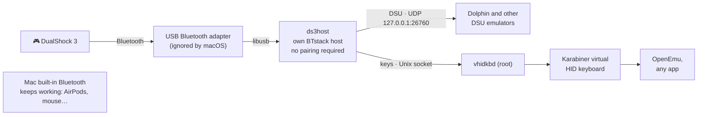

# DS3Bridge — PS3 DualShock 3 over Bluetooth on modern macOS

**Use a PlayStation 3 DualShock 3 controller wirelessly on modern macOS (macOS 13+; tested on macOS 26 Tahoe, Apple Silicon).**

[Leer en español](README.es.md)

Since macOS Monterey, a DualShock 3 only works **by cable** (with an activation tool such as `ds3activate`). Over Bluetooth macOS shows an endless "enter a code" pairing window and drops the connection after ~30 s. DS3Bridge works around this **without disabling SIP, without kernel extensions and without Apple-only entitlements**, using:

- a **cheap USB Bluetooth adapter** that macOS ignores and that DS3Bridge drives directly with its own Bluetooth stack ([BTstack](https://github.com/bluekitchen/btstack)). The built-in Mac Bluetooth keeps working normally for your other devices;
- a **DSU (cemuhook) server** so emulators like Dolphin can read the controller (buttons, sticks, pressure, basic motion);
- a **keyboard mode** that turns the controller into key presses, either through the signed [Karabiner virtual HID keyboard](https://github.com/pqrs-org/Karabiner-DriverKit-VirtualHIDDevice) (needed for OpenEmu) or through synthetic key events.

> ⚠️ **Status: experimental, personal project.** It works on the author's setup (see *Tested hardware*). See the [notes](#notes) below.

## How it works (short version)



The DS3 never does real Bluetooth pairing (no link key). macOS 12+ requires authenticated pairing for every Bluetooth HID device, so it rejects the DS3 — and apps cannot bypass that policy because `bluetoothd` owns the HID channels. With a second adapter controlled by our own stack, *we* decide the security policy, just like the PS3 did. Full story in [docs/HOW_IT_WORKS.md](docs/HOW_IT_WORKS.md).

## Requirements

- A Mac with macOS 13 or newer (developed on macOS 26, Apple Silicon).
- A **USB Bluetooth adapter**. Only an old ISSC `0x1131:0x1004` (Bluetooth 2.1) has been tested; other standard USB Bluetooth dongles *should* work, but that is unconfirmed — please report yours. On Apple Silicon, macOS does not use external adapters, so it stays free for DS3Bridge. A USB-C hub or USB-C → USB-A adapter if your Mac only has USB-C.
- A DualShock 3 (or Sixaxis) and a **Mini-USB** cable (only for the one-time pairing).
- Xcode Command Line Tools (`xcode-select --install`) and [Homebrew](https://brew.sh) with `libusb` and `pkg-config`.

### The hardware

<table>
<tr>
<td align="center" width="25%"><br><sub>DualShock 3</sub></td>
<td align="center" width="25%"><br><sub>USB Bluetooth adapter</sub></td>
<td align="center" width="25%"><br><sub>USB-C hub (or USB-C → USB-A adapter)</sub></td>
<td align="center" width="25%"><br><sub>Mini-USB cable (pairing only)</sub></td>
</tr>
</table>

## Step by step

### 1. Build

```sh
brew install libusb pkg-config
git clone https://github.com/comechejlg/DS3Bridge.git
cd DS3Bridge
./build.sh
```

`build.sh` downloads BTstack and the Karabiner client headers at **pinned, tested commits**, applies the small patches in `patches/`, and puts three programs in `bin/`:

| Program | What it does |
|---|---|
| `ds3host` | Drives the USB Bluetooth adapter, accepts the DS3, reads its reports, serves DSU and keyboard mode. Runs as your user. |
| `vhidkbd` | Tiny root service that forwards keys to the Karabiner virtual HID keyboard. |
| `ds3bt` | One-time pairing over USB: writes the adapter's Bluetooth address into the controller. |

### 2. First run (learn the adapter address)

Plug in the USB Bluetooth adapter and double-click **`scripts/Start DS3Bridge.command`**. You should see `Adaptador listo. Dirección Bluetooth del adaptador: …` ("adapter ready"). The address is saved to `~/Library/Application Support/DS3Bridge/adapter-address`. Close the window.

macOS may ask to give Terminal **Accessibility** permission; this is only needed for the synthetic-key fallback (see step 5) and you can skip it if you will install the Karabiner service.

### 3. Pair the controller (once)

Connect the DS3 with its USB cable and double-click **`scripts/Pair controller (USB cable).command`**. It must end with `OK: el mando apunta ya a este Mac.` ("the controller now points to this Mac"). Unplug the cable.

You only repeat this if you use the controller with a PS3 or another device.

### 4. Try it

Open **`scripts/Start DS3Bridge.command`** again and press **PS**. The controller rumbles briefly and LED 1 stays on. Moving sticks and pressing buttons shows the live state in the terminal.

### 5. Use it in games

**Emulators with DSU support (Dolphin, Cemu, …)** — nothing else to install. *The DSU server has been verified with a protocol test client, but not yet confirmed inside Dolphin: feedback welcome.*
In Dolphin: *Controllers → Alternate Input Sources → DSU Client*, enable it and add server `127.0.0.1`, port `26760`. Then choose the device starting with `DSUClient/0/` in the controller configuration.

**OpenEmu (and any app that reads the keyboard)** — keyboard mode. OpenEmu only accepts *real HID keyboards* during gameplay, so you need the Karabiner virtual keyboard:

1. Double-click **`scripts/Install Karabiner driver.command`**. It downloads the official signed and notarized package, verifies the signature (Developer ID *Fumihiko Takayama*, team `G43BCU2T37`) and opens the installer.
2. Approve the driver in *System Settings → General → Login Items & Extensions → Driver Extensions (ⓘ)* → enable **Karabiner-VirtualHIDDevice**.
3. Double-click **`scripts/Install service.command`** (asks for your password once). It installs the Karabiner daemon and `vhidkbd` as system services and creates **DS3Bridge.app** in Applications.
4. From now on just open **DS3Bridge** from Applications and press PS. No password. (The app points to this folder: if you move the repository, run `Install service` again.)
5. In OpenEmu: *Preferences → Controls*, choose the system, click each button and press it on the controller.

Without the service, keyboard mode falls back to synthetic key events (needs Accessibility permission for Terminal): fine for most apps, **not** for OpenEmu gameplay.

### Keyboard mapping

| Controller | Key | | Controller | Key |
|---|---|---|---|---|
| D-pad | Arrow keys | | L1 / R1 | Q / E |
| Left stick | W A S D | | L2 / R2 | 1 / 3 |
| Right stick | I J K L | | L3 / R3 | F / H |
| Cross / Circle | X / C | | Start | Return |
| Square / Triangle | Z / V | | Select | N |

**PS button** pauses/resumes keyboard mode (LED 1 = active, LED 4 = paused) so the controller does not type into other apps. Sticks are digital in keyboard mode (pressed or not).

## Notes

- The pressure-sensitive buttons are read from their analog value with a threshold, because some controllers report the digital bits as "pressed" at rest.
- Motion data sent over DSU is approximate (the DS3 has a 3-axis accelerometer and a single gyro axis).
- On-screen messages of the programs are currently in Spanish.

## Tested hardware

- MacBook Air M1, macOS 26.7.1 (Tahoe)
- USB Bluetooth adapter ISSC "EDRBTA" `0x1131:0x1004` (Bluetooth 2.1 + EDR) behind a USB-C hub
- DualShock 3, OpenEmu-Silicon v23 (DeSmuME core) — keyboard mode confirmed in-game
- DSU server: tested with a protocol client only
- Unplugging the USB adapter while DS3Bridge is running: no problems

Reports with other adapters/controllers are welcome — please open an issue.

## Uninstall

`scripts/Uninstall service.command` removes the services and the app. To remove the Karabiner driver: `/Applications/.Karabiner-VirtualHIDDevice-Manager.app/Contents/MacOS/Karabiner-VirtualHIDDevice-Manager deactivate`.

## Troubleshooting

See [docs/TROUBLESHOOTING.md](docs/TROUBLESHOOTING.md).

## Credits & licenses

DS3Bridge's own code is MIT-licensed (see [LICENSE](LICENSE)). It builds on third-party work with **different licenses** — notably **BTstack, which is free for non-commercial use only**. See [THIRD_PARTY_NOTICES.md](THIRD_PARTY_NOTICES.md).

Thanks to vit9696 (`ds3activate`), BlueKitchen (BTstack), Fumihiko Takayama / pqrs.org (Karabiner VirtualHIDDevice), the Linux `hid-sony` driver authors and the cemuhook/DSU protocol documenters.
